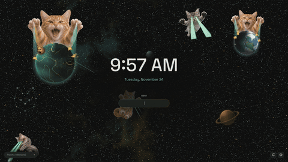
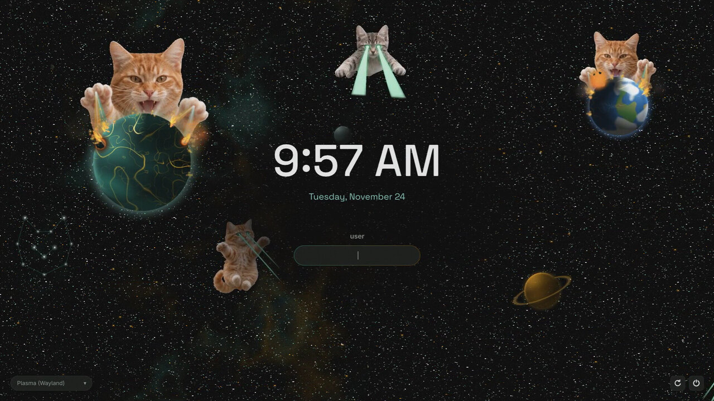
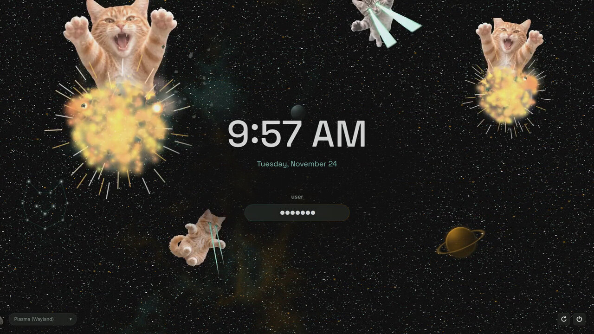
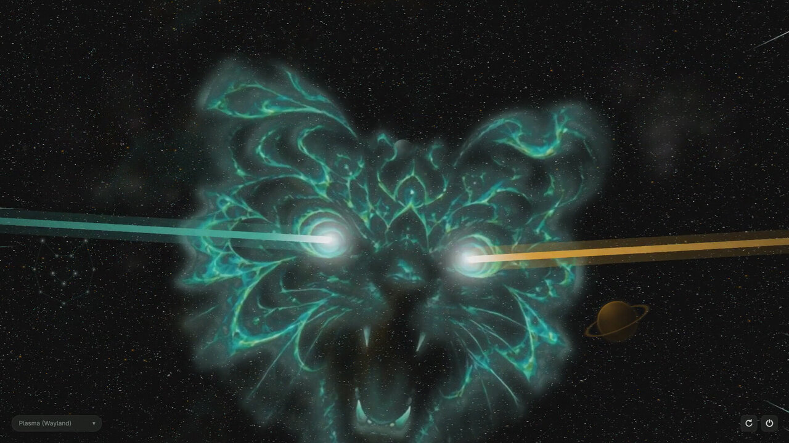

# Laser Cats: an SDDM login theme

[](https://github.com/wolfcolatom/laser-cats-sddm/actions/workflows/check.yml)

An animated space login screen. Laser-eyed kittens float through a drifting
starfield and nebula; two tabbies rise out of burning planets, firing lasers
from their paws that chip pieces off them. Typing makes the cats flash (and
chips the planets); a wrong password washes everything amber. Press Enter
with the right password and the planets explode, the cats are flung off
screen, a roaring neon vortex cat appears, and everything warps away into your
session.



| Waiting for you | The planets blow up | The warp |
|---|---|---|
|  |  |  |

**Classic cats (optional).** Before 1.4 the theme used cats cut out of GIFs
on GIPHY. Their artists haven't licensed them for sharing, so they aren't in
this package, but `get-cats.sh` can download the GIFs from GIPHY and make the
classic cats on your own computer, for your own use. The theme switches to
them by itself. See "Classic cats" below.

## Requirements

- **SDDM 0.21 or newer with the Qt 6 greeter** (`sddm-greeter-qt6`)
- **Qt 6.8 or newer** (tested on 6.8 and the current release): Quick with Effects, Shapes and Particles (Arch:
  `qt6-declarative`), SVG (`qt6-svg`) and image formats for the animated
  WebP cats (Arch: `qt6-imageformats`, Debian/Ubuntu:
  `qt6-image-formats-plugins`, Fedora: `qt6-qtimageformats`). Plasma
  usually has them all already.
- **GPU acceleration for SDDM**, for the animation. Without it (Qt's
  software renderer) the theme holds the sky still and logs in calmly (see
  `calm`). If the screen stays black, SDDM's X server isn't accelerated (on
  some Intel machines the old `xf86-video-intel` driver causes this; the
  `modesetting` driver fixes it).
- Optional: `qt6-virtualkeyboard` for the on-screen keyboard.

Works at any screen size and scaling (1080p to 4K, ultrawide, HiDPI): the
starfield and nebula scale up to fill the screen and the cats and planets
scale with its height. On several screens the sky shows on all of them and
the login controls on the primary one.

With one account the screen shows its name; with several, a list; and if
SDDM lists none, a field to type it. Set `askUsername=true` to always get
the field (for network accounts SDDM doesn't list).

## Changes

See [CHANGELOG.md](CHANGELOG.md).

## Install

The easy way: System Settings → Colors & Themes → Login Screen (SDDM) →
Get New… → search "Laser Cats" ([KDE Store page](https://store.kde.org/p/2382576)).

From GitHub, with git:

```
sudo git clone https://github.com/wolfcolatom/laser-cats-sddm.git /usr/share/sddm/themes/laser-cats
printf '[Theme]\nCurrent=laser-cats\n' | sudo tee /etc/sddm.conf.d/laser-cats.conf
```

Update it later with `sudo git -C /usr/share/sddm/themes/laser-cats pull`.

Or with `make` (also what packagers use):

```
sudo make install          # PREFIX=/usr, DESTDIR for packaging
printf '[Theme]\nCurrent=laser-cats\n' | sudo tee /etc/sddm.conf.d/laser-cats.conf
```

There's an Arch PKGBUILD in `packaging/arch/`.

Or from a release archive
([releases](https://github.com/wolfcolatom/laser-cats-sddm/releases)):

```
tar -xzf laser-cats-sddm-*.tar.gz
sudo cp -r laser-cats /usr/share/sddm/themes/
printf '[Theme]\nCurrent=laser-cats\n' | sudo tee /etc/sddm.conf.d/laser-cats.conf
```

Preview it first, in a window (it closes by itself after 30 seconds):

```
timeout 30 sddm-greeter-qt6 --test-mode --theme /usr/share/sddm/themes/laser-cats
```

**The preview can't log anyone in.** It looks exactly like the real login
screen but isn't connected to SDDM, so typing your password and pressing
Enter plays the explosion and then does nothing. That's expected.

To go back to SDDM's default theme:
`sudo rm /etc/sddm.conf.d/laser-cats.conf`

## Plasma wallpaper (Plasma Login Manager, desktop, lock screen)

The sky also comes as a standard Plasma wallpaper plugin, without the login
screen. Use it for **Plasma Login Manager** (KDE's newer login manager,
which takes Plasma wallpapers instead of SDDM themes), or as your Plasma
desktop or lock screen wallpaper. A wallpaper doesn't know when you press
Enter, so there is no explosion or warp: the cats float and the planet cats
fire their lasers.

Install it for everyone (Plasma Login Manager only sees wallpapers
installed this way):

```
sudo make install-wallpaper
```

or from the release's `laser-cats-wallpaper-*.tar.gz`:

```
sudo kpackagetool6 --type Plasma/Wallpaper --global --install laser-cats-wallpaper-*.tar.gz
```

Then pick **Laser Cats** as the wallpaper in System Settings → Login Screen
(for Plasma Login Manager), or in the desktop's or lock screen's wallpaper
settings. For Plasma Login Manager it can also be set by hand in
`/etc/plasmalogin.conf`:

```
[Greeter]
WallpaperPluginId=org.wolfcolatom.lasercats
```

Its one setting, **Calm** (no shooting stars or comet), is in the wallpaper
settings, or for Plasma Login Manager in `/etc/plasmalogin.conf`:

```
[Greeter][Wallpaper][org.wolfcolatom.lasercats][General]
Calm=true
```

Without GPU acceleration the sky is held still. To remove it:
`sudo make uninstall-wallpaper` (or `sudo kpackagetool6 --type
Plasma/Wallpaper --global --remove org.wolfcolatom.lasercats`).

## Classic cats

To use the original GIF cats instead of the theme's own (needs `curl`,
ImageMagick 7 and python3 with numpy; it asks for sudo only to copy the cats
into the theme folder):

```
bash /usr/share/sddm/themes/laser-cats/get-cats.sh
```

It downloads three GIFs from GIPHY, cuts the cats out and puts them in the
theme's `assets` folder, then sets `classic=true` in the theme's
`theme.conf.user` (SDDM's file for local settings); the theme then uses
them, with their own layout and lasers. To go back to the theme's own cats:

```
bash /usr/share/sddm/themes/laser-cats/get-cats.sh --remove
```

Updating the theme removes the classic cats, so run it again after an
update. They're made from the artists' work for your own use: please don't
share them.

## How the login works

SDDM closes the login screen the moment a password is accepted, so the
explosion and warp (about 2.2 s) play **as soon as you press Enter**, and
only then is the password handed to SDDM. A wrong password rewinds it all:
the planets and cats fly back together, washed amber. If SDDM doesn't
answer within 15 seconds, the password field comes back by itself.

## Settings (`theme.conf`)

Change them in `theme.conf`, or better in `theme.conf.user` next to it
(SDDM reads both, and an update won't overwrite your own file):

```
[General]
calm=true
```

- `calm`: a gentler screen, for anyone sensitive to motion or on battery:
  no explosion or warp when you log in (it logs straight in, with no
  2-second wait), no flashing as you type, no shooting stars or comet.
  `auto` (the default) is calm only without GPU acceleration; `true` always;
  `false` never.
- `timeFormat`, `dateFormat`: the clock and date, in
  [Qt's format](https://doc.qt.io/qt-6/qml-qtqml-date.html#format-strings)
  (for example `HH:mm` and `dddd d MMMM`). Empty (the default) follows your
  language and 12/24-hour setting.
- `askUsername`: `true` shows a field to type the username instead of
  SDDM's list of users (for network accounts it doesn't list).
- `keyboard`: `true` adds an on-screen keyboard button, for touch screens.
  It needs `qt6-virtualkeyboard` and `InputMethod=qtvirtualkeyboard` in
  SDDM's own settings (`/etc/sddm.conf.d/`).
- `accent`: the colour the password field's edge starts with.
- `classic`: set by `get-cats.sh` (see Classic cats).

## Accessibility

- Every control has a name and role for screen readers.
- Everything works from the keyboard: Tab moves between the password, the
  account and session lists and the power buttons (with a visible ring),
  Enter or Space presses them, Escape clears the password.
- Text meets WCAG AA contrast (checked by the tests).
- Messages from SDDM (an account locked, a password about to expire) and
  the Caps Lock warning are announced as alerts.
- `calm` for anyone sensitive to motion; right-to-left languages mirror
  the layout.

## Files

See [docs/ARCHITECTURE.md](docs/ARCHITECTURE.md) for how it fits together.
In short: `login/` is the login screen (and the one file that talks to
SDDM), `sky/` the animated sky, one file per part, with every cat's picture
and paw/eye positions in `sky/CatSets.qml`; `style/Theme.qml` holds the
colours. `Main.qml` only joins them.
`wallpaper/` wraps the same `sky/` as a Plasma wallpaper plugin (`make
wallpaper` assembles it). `tools/` draws the stars, nebula and planets;
`get-cats.sh` makes the optional classic cats; `tests/` and `ci/` hold the
checks.

## Translations

German, Spanish, French, Italian, Japanese, Dutch, Polish, Brazilian
Portuguese, Russian and Simplified Chinese; the clock and date follow your
language too. To add one, see [translations/README.md](translations/README.md).

## Development

[CONTRIBUTING.md](CONTRIBUTING.md) has the details. `make check` runs what
CI runs on every change: Qt's linter with no warnings allowed, the test
suites (the login flow, the cat data, contrast, the random numbers),
headless runs (normal, calm, no GPU, HiDPI, right-to-left), screenshot
comparisons of the sky, and every translation. Performance figures are in
[docs/PERFORMANCE.md](docs/PERFORMANCE.md), where the art comes from in
[docs/ART.md](docs/ART.md), and how the password is handled in
[SECURITY.md](SECURITY.md).

## Credits and licence

Code and theme-made artwork: GPL-3.0-or-later (`LICENSE`). The clock font,
Space Grotesk, is under the SIL Open Font License. See `CREDITS.md`.
